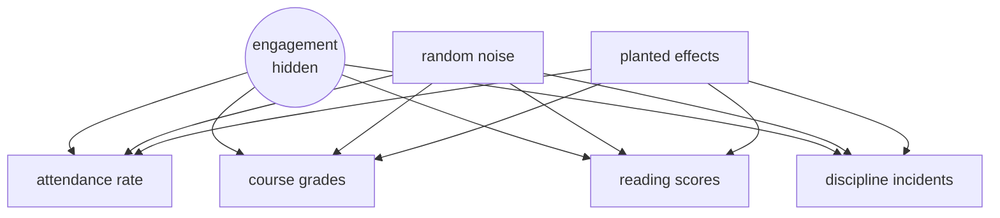

# 01 · Synthetic data with planted patterns

> [!abstract] In one sentence
> We generate fake but believable student data from a fixed seed, and deliberately
> hide a few known patterns in it. That way we know the right answers before we ever
> ask the RAG system a question.

## Why fake data first

- **Privacy:** real student records are protected by FERPA. Fake data has no risk, so
  you can commit the generator, share it, and break things freely.
- **Ground truth:** with real data you never know what the "right" answer is. With
  planted patterns you do, which makes evaluation possible later ([[07-evaluating-rag]]).
- **Repeatable:** same seed gives the same data every time. A bug you see today, you
  can see again tomorrow.

## How it works

### 1. Seeded randomness

All randomness comes from **one** generator object created from a seed. Never call
`np.random.rand()` directly (that uses hidden global state).

```python
rng = np.random.default_rng(42)          # the only source of randomness
rng.normal(loc=70, scale=10, size=5)     # 5 numbers around 70
rng.choice(["A", "B"], size=5, p=[0.8, 0.2])
rng.random(5) < 0.1                      # True about 10% of the time
```

> [!tip] Pass `rng` into every function
> Each `make_*` function takes `rng` as its first argument. That keeps the whole
> dataset reproducible from one number.

### 2. A hidden "latent" factor drives everything

Real data is *correlated*: a student who misses school also tends to have lower grades
and reading scores. If you generate each column independently, nothing correlates
and there is nothing to find.

The trick: give each student a hidden **engagement** score (never stored), and derive
the visible columns from it plus noise.



### 3. Planted patterns on top

After the base data looks realistic, add a few specific effects on purpose. These are
the answers the RAG system must find.

| ID | Pattern | How to plant it | What the eval will ask |
|---|---|---|---|
| P1 | Chronically absent students (missed ≥ 10% of days) read below peers; the gap is largest in grade 7 | Subtract points from reading scores for chronic absentees, more in grade 7 | "How does chronic absence relate to reading scores, and in which grade is the gap largest?" |
| P2 | ELL students start lower in fall but grow faster by spring | Lower the fall score for ELL students, add extra growth each window | "How do ELL students' reading scores change across the year?" |
| P3 | Algebra I has about twice the D/F rate of any other course | Shift Algebra I grades down | "Which course has the highest D/F rate?" |
| P4 | Students with 3+ discipline incidents average a full letter grade lower | Tie incident count to engagement, plus an extra grade penalty at 3+ | "How do discipline incidents relate to grades?" |
| P5 | FRL students in tutoring close most of the reading gap with non-FRL peers | FRL lowers reading; tutoring adds most of it back | "Does tutoring help FRL students' reading?" |

> [!warning] Don't plant effects on race or gender
> Planting "group X scores lower" for a race or gender would bake a stereotype into the
> data, and the RAG system would then "discover" it as if it were true. Our patterns
> use **conditions and programs** (attendance, ELL, FRL, IEP, tutoring), which is what
> real school research focuses on. Demographic columns still exist, so you can ask
> about them, but they get no planted effect. The honest answer is "no meaningful gap".
> That also makes a good eval question: the system should not invent a pattern.

## Key terms

- **Seed**: the number that fixes all the randomness. Same seed, same data.
- **Latent variable**: a hidden cause you never store, used so that visible columns
  correlate realistically.
- **Planted pattern**: an effect added on purpose so we know the ground truth.
- **Chronic absence**: missing 10% or more of school days (the standard US definition).
- **ELL / IEP / FRL**: English language learner / special education plan /
  free or reduced-price lunch (a poverty proxy).
- **Referential integrity**: every `student_id` in a child table exists in `students`.

## In this project

School: one middle school, grades 6–8, about 2,000 students, one school year
(180 days, fall and spring semesters, reading tests in fall, winter, and spring).

**File you'll write:** `src/student_rag/data/generate.py`

| Function | Returns | Notes |
|---|---|---|
| `make_students(rng, n)` | students table + hidden engagement array | grade 6–8, demographics, ell/iep/frl flags, tutoring flag (mostly FRL kids) |
| `make_courses()` | courses table | fixed list, no randomness: ELA, math (Math 6, Math 7, Algebra I), science, social studies per grade |
| `make_enrollments(rng, students, engagement, courses)` | grades per student per course per semester | grade % from engagement + noise; P3, P4 |
| `make_attendance(rng, students, engagement, n_days)` | one row per student per day | status: present, absent, tardy; P1 needs the absence rate |
| `make_reading(rng, students, engagement, absence_rate)` | 3 rows per student | P1, P2, P5 |
| `make_discipline(rng, students, engagement)` | incident rows | most students 0; a few with many |
| `write_db(path, tables)` | nothing | drops and recreates every table in DuckDB |
| `main(seed=42, path="data/students.duckdb")` | nothing | calls the above in order; run with `uv run python -m student_rag.data.generate` |

Teacher notes (free text for vector search) come in [[03-chunking-and-embeddings]];
we'll add `make_notes` then.

> [!tip] Order matters
> Attendance comes before reading because P1 needs each student's absence rate.
> Write and test the functions top to bottom.

> [!example] Getting numpy arrays into DuckDB
> DuckDB can read a Python `dict` of numpy arrays directly by variable name:
> `con.execute("CREATE TABLE students AS SELECT * FROM students_dict")`.
> Check this in the DuckDB 2.x Python docs before relying on it.

### Tests you'll write: `tests/test_generate.py`

1. **Reproducible:** two runs with seed 42 give identical tables; seed 7 gives different ones.
2. **Integrity:** every `student_id` in enrollments, attendance, reading, and discipline exists in students.
3. **Ranges:** grade % in 0–100, statuses only from the allowed set, three reading rows per student.
4. **Each planted pattern is detectable**, for example: the mean reading score of chronic
   absentees is at least 8 points lower than everyone else's.
5. **No race/gender effect:** the mean reading score per race group is within a few points of the overall mean.

> [!warning] Watch out
> - Clip values into valid ranges (`np.clip`), because normal distributions can produce 104% or -3%.
> - Make planted effects big enough to survive noise (test #4 catches this), but not so
>   big they look fake.
> - Attendance is about 360k rows (2,000 × 180). Build it with numpy arrays, not a Python
>   loop that appends one row at a time.

## Check yourself

> [!question]- Why pass `rng` around instead of calling `np.random.seed(42)` once?
> Global state can be changed by any code, including libraries, so reproducibility
> breaks silently. An explicit `rng` object is local and obvious.

> [!question]- Why use a hidden engagement score instead of just making absence lower grades directly?
> Real causes are tangled. A shared hidden factor makes *all* the columns correlate
> with each other, like real data does. Planted patterns are then extra, specific
> effects on top that we can test for exactly.

> [!question]- If the RAG system says "Asian students score lowest in reading", is that a finding?
> No. We planted no race effect, so this is the system inventing a pattern
> (a hallucination, or noise read as signal). The eval should catch it.

## Links

- Next: [[02-schema-as-context]]
- Back to [[README|Learning log]]
