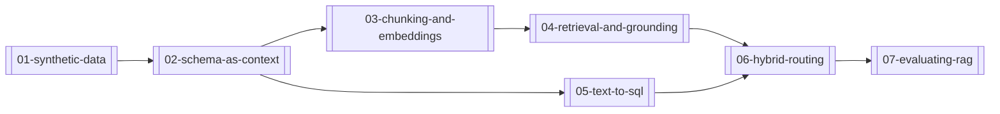

# Learning log

> [!info] How to read this
> Open `docs/learning/` (or the whole project) as an Obsidian vault. Each note is one
> concept, written alongside the task that teaches it. Start at the top and follow the
> **Next** link at the bottom of each note.

| # | Concept | Task | Status |
|---|---|---|---|
| 01 | [[01-synthetic-data]] | T-006 | not started |
| 02 | [[02-schema-as-context]] | T-007 | not started |
| 03 | [[03-chunking-and-embeddings]] | T-008 | not started |
| 04 | [[04-retrieval-and-grounding]] | T-009 | not started |
| 05 | [[05-text-to-sql]] | T-010 | not started |
| 06 | [[06-hybrid-routing]] | T-011 | not started |
| 07 | [[07-evaluating-rag]] | T-012 | not started |

New notes start from [[_template]].
