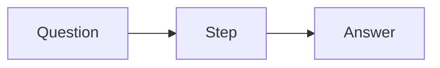

# 00 · Concept name

> [!abstract] In one sentence
> What this is and why a RAG system needs it.

## How it works

Plain explanation in short paragraphs. Add a diagram when there's a flow:

## Key terms

- **Term**: meaning in one line

## In this project

- Where it lives: `src/student_rag/...`
- What you wrote and why it's shaped that way

> [!example] Try it
> A command or notebook cell to run and what you should see.

> [!warning] Watch out
> The common mistake or failure mode.

## Check yourself

> [!question]- Question you should now be able to answer
> Answer (collapsed until clicked).

## Links

- Previous: [[00-previous]] · Next: [[00-next]]
- Back to [[README|Learning log]]
